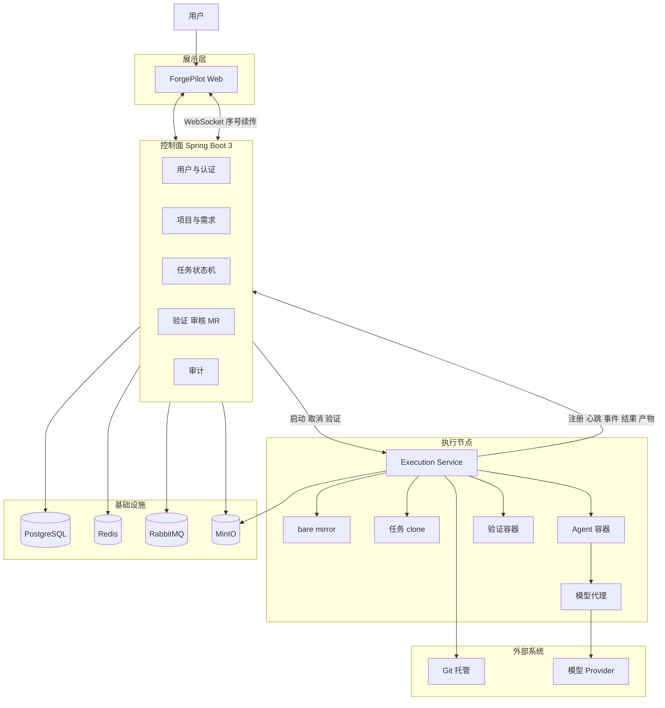
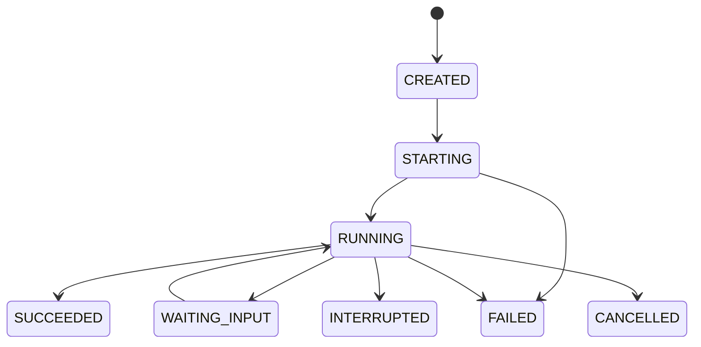
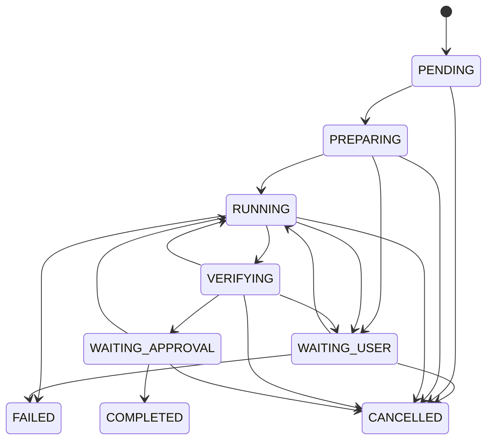
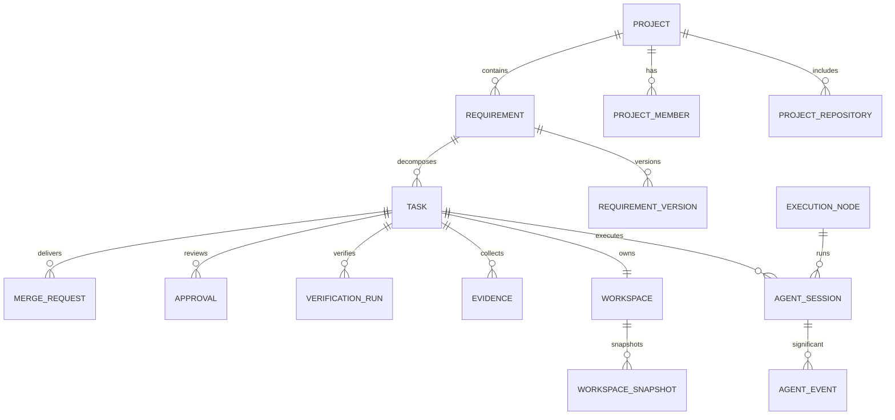
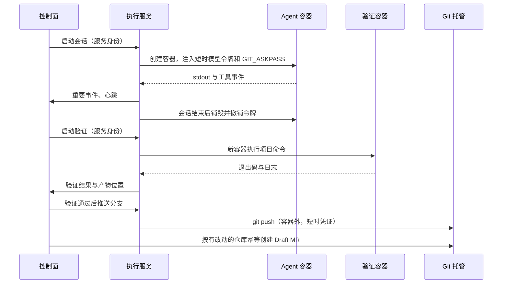

# ForgePilot

## 系统基础架构设计说明书

**英文名称：** ForgePilot  
**中文名称：** 云端 AI Coding 平台  
**文档版本：** Architecture V1.2  
**日期：** 2026-11-08  
**架构阶段：** MVP  
**架构风格：** 模块化单体 + 独立 Agent 执行面  
**核心技术：** Spring Boot 3 + Vue 3 + PostgreSQL + Redis + RabbitMQ + Docker

产品行为以 [MVP 需求规格说明书](../requirements/mvp-prd.md) 为准。本文说明这条行为如何落在进程、数据和网络上。

## 变更说明（相对 V1.1）

V1.2 是架构基线。下列决定已经替换正文中的旧方案。V1.1 里没有被本节改写的结构仍然有效。

1. 一个项目关联多条仓库。一次任务仍是一个工作区目录，目录内每个仓库一次 clone。快照覆盖每个检出。
2. 统一交付是同名分支 `fp/{taskId}` 加上每个有改动仓库一条 Draft MR，再做一次任务级审核。不把多个远端合并成一个 Git 历史。
3. 控制面自建。MVP 运行时是容器内的 Codex CLI。OpenHands Agent Server 和 ACP 只留端口。模型代理对 Agent 只暴露 Responses。
4. 租户管理员维护本公司的编码工具和模型目录。项目设默认，任务可覆盖工具、Provider 和模型。非 Responses 上游在翻译网关配置之前不能给 Codex 使用。
5. 并发任务的隔离是硬约束：独立可写目录、容器、网络、进程和会话凭证。bare mirror 只读共享。仓库不排他。任务启动时冻结仓库集合和各仓库基线分支。
6. 个人工作台是前端首页，先按租户和项目成员收口，再按阶段展示详情，并提供「待我处理」。
7. 撤回单组织。租户是公司，项目是公司内的项目团队。四种角色。普通用户只属于一个租户。不做计费型 SaaS，也不跨租户共享。
8. 规约与文档分平台、公司、项目三层。会话启动时快照合成结果。操作记录只追加，供审计和日报，密钥打码。

---

# 1. 架构目标

## 1.1 建设目标

ForgePilot 在多个公司租户上调度 AI Agent 完成代码修改。公司数据互相隔离。MVP 要稳定支持：

- 需求、可编辑的分析草稿和经用户确认的任务拆分。
- 执行节点上的独立工作区与 Docker 沙箱。
- 平台在另一容器中执行项目配置的验证命令。
- 由平台按有改动的仓库推送同名分支并创建 Draft MR，再做一次任务级审核。
- 人工审核后形成交付记录。
- 节点失效后按快照恢复未推送的工作。

分析草稿只基于需求文本和可选的文件树或 README。架构不为 MVP 安排代码索引或语义检索服务，因此也不宣称影响模块、数据库或 API 的自动识别是可靠的。

## 1.2 架构原则

| 原则 | 设计要求 |
| --- | --- |
| 控制执行分离 | 控制面与执行面独立进程 |
| 模块化 | 一个应用内按包划分领域，边界稳定前不拆微服务 |
| 可扩展 | Agent、沙箱、Git、模型都通过适配器接入 |
| 可恢复 | 权威状态在 PostgreSQL；未推送代码有快照 |
| 证据驱动 | 完成由验证证据和审核决定 |
| 安全隔离 | 每任务独立工作区、容器、网络和短时凭证；仓库 mirror 只读共享 |
| 事件分流 | 状态事件走 Outbox；高频输出不进消息队列 |
| 渐进建设 | 固定状态机，不做 DAG 引擎和多 Agent 网络 |

---

# 2. 总体结构

## 2.1 分层

1. 展示层：Vue 应用和 WebSocket。
2. 业务控制层：Spring Boot 控制面。
3. Agent 执行层：执行节点上的 Execution Service、模型代理和 Docker。
4. 基础设施层：PostgreSQL、Redis、RabbitMQ、MinIO。
5. 外部系统：Git 托管和模型 Provider。MVP 的 Git 适配器实现连接 GitLab。

## 2.2 逻辑结构



Agent 容器的出站只到达 Git 主机、模型代理和包仓库。它不到达控制面、PostgreSQL、Redis、RabbitMQ、MinIO 和云元数据服务。验证容器不到达模型代理。

## 2.3 控制面

控制面保存全部业务状态，是任务状态的唯一权威。

职责：

- 本地用户、JWT、四种角色、菜单权限、租户边界和项目成员。
- 项目、多条仓库连接、需求和需求版本。
- 本公司的编码工具目录和模型 Provider 目录，以及项目默认和任务覆盖。
- 三层规约与文档，以及会话启动时的合成快照。
- 分析草稿的保存与确认。
- 任务状态机、冻结的仓库集合、PostgreSQL 中的执行队列、节点选择。
- Session 元数据和重要事件。
- 验证编排、审核、按仓库的 MR 记录和交付记录。
- 只追加的操作记录。
- 把执行节点上报的产物索引到 MinIO。

控制面进程不启动 Agent，不挂载执行节点磁盘，不通过 SSH 读取工作区。

## 2.4 执行面

每个执行节点运行 Execution Service。它：

- 向控制面注册并心跳。
- 维护仓库 bare mirror。
- 为任务创建独立工作区，把项目的每个仓库克隆到稳定子目录，再把整个目录挂进容器。
- 启动和销毁 Agent 容器与验证容器。
- 运行模型代理。
- 采集日志和 Diff，上传 MinIO。
- 按控制面的指令，在 Agent 容器之外执行 `git push`。
- 上报重要事件、心跳、结果和产物位置。

执行面不修改任务的最终状态，不直接写业务表。它只调用控制面的内部接口。

---

# 3. 后端结构

## 3.1 一个应用，四个包

MVP 的控制面是一个 Spring Boot 3 应用。先按包隔离，不拆成多个 Maven 业务模块。十二个模块的划分会在边界尚未被闭环验证时制造大量跨模块接口，因此不采用。

```
forgepilot-server/
└── src/main/java/.../forgepilot/
    ├── system/        用户、JWT、角色、菜单权限、审计
    ├── project/       项目、成员、仓库连接、需求、需求版本、分析草稿
    ├── execution/     任务、状态机、队列、Agent 配置、Session、
    │                  节点、工作区元数据、证据索引
    └── delivery/      验证编排、审核、MR、交付记录
```

包之间通过应用服务接口协作。禁止为了省事去读写另一个包拥有的表。

Execution Service 是第二个可运行进程。它可以放在同一仓库的另一个目录，例如 `forgepilot-execution/`，但不得并进控制面进程，也不得作为上述四个包里的一个 Spring Bean 去调用 Docker。

Git 适配器和模型 Provider 配置可以放在使用它们的包内：仓库连接放在 `project`，推送与 MR 放在 `delivery` 所调用的端口后面，Provider 密钥的保存放在 `system` 或 `project` 的集成配置中。端口的实现类可以依赖 GitLab SDK；领域类不可以。

Flyway 脚本放在控制面应用的 `classpath:db/migration`。执行面不拥有业务库，不单独建一套迁移。

## 3.2 包职责

| 包 | 职责 |
| --- | --- |
| system | 登录、密码散列、JWT、四种角色、租户、菜单、模型目录、规约与文档、操作记录 |
| project | 项目成员边界、多条仓库连接、需求版本、分析草稿确认 |
| execution | 任务状态、排队、把 Session 分到节点、保存节点心跳、索引证据 |
| delivery | 决定何时验证、何时推送、MR 幂等、审核和交付记录 |

执行进程的内部模块建议为：`node`、`mirror`、`workspace`、`sandbox`、`agent adapter`、`model proxy`、`collector`。这些名字属于执行服务，不是控制面的第五个包。

---

# 4. Agent 执行

## 4.1 适配器

控制面只保存 Agent 类型和声明的能力。真正启动进程的是执行节点上的适配器。

```java
public interface AgentAdapter {
    AgentType getAgentType();
    AgentCapabilities getCapabilities();
    void start(AgentExecutionContext context);
    void sendMessage(String sessionId, String message);
    void cancel(String sessionId);
    AgentSessionStatus status(String sessionId);
}
```

`AgentCapabilities` 至少包括：交互输入、原生暂停、中断、事件流、工具调用事件、会话恢复、结构化结果。

控制面是 ForgePilot 自己的，不把 OpenHands 或其他 Coding Agent 产品分叉进本仓库，也不在 MVP 里写一套 Java 或 Python Agent 循环。

MVP 实现 Codex CLI 适配器。平台准备多仓库工作区和沙箱，Codex CLI 在 Agent 容器内运行。`git push` 和 Draft MR 仍由平台执行。Codex 当前声明中断、事件流、工具事件、工作区内的 CLI 会话恢复和结构化结果；不声明原生暂停，也不声明向仍在运行的进程发消息。平台不得假设所有 Agent 都能暂停或恢复原进程。未声明原生暂停时，取消并在同一工作区创建新 Session。

OpenHands Agent Server（REST/WebSocket）和 ACP 兼容 Agent 只保留端口，不能被选为当前运行时。

执行上下文包含任务、会话、项目、需求版本、工作区根路径、该任务的 Agent 家目录、Agent 类型和策略标识。上下文里不放长期密钥，也不放 Provider API Key。模型入口只放本次选定 Provider 的会话级代理地址和短时令牌。Codex 的 `wire_api` 固定为 `responses`。

## 4.2 Session 生命周期



任务重试创建新 Session。节点心跳超时把未结束的 Session 标为 `INTERRUPTED`。

Session 的 `FAILED` 或 `INTERRUPTED` 不直接等于任务 `FAILED`。控制面状态机见第 6 章。

---

# 5. 工作区与沙箱

## 5.1 为何不用 Git Worktree

V1.0 曾把 Git Worktree 当作任务隔离手段。V1.1 放弃该方案，原因是：

1. worktree 中的 `.git` 文件记录它所指向的仓库在宿主机上的绝对路径。容器里的路径只要有一处不同，Git 就无法解析该仓库。除非把该仓库挂到完全相同的路径再挂进每一个容器，否则隔离就会破掉。
2. 同一仓库的多个 worktree 共享对象库和锁。一个任务运行 `git gc`、打包或长时间持有 `index.lock` 时，其他任务会被阻塞或受到对象库变更的影响。

因此 worktree 不能作为容器场景下的主隔离机制。

## 5.2 bare mirror 与独立 clone

每个执行节点为每条仓库连接保留一个 bare mirror，用平台凭证定期 `fetch`。mirror 不属于任何任务，只供只读引用。

每个任务在该节点上有一个工作区目录。平台把项目关联的每一个仓库克隆到该目录下的稳定子目录，目录名来自仓库连接。Agent 家目录也在这个任务目录里，不使用节点上共享的 Codex 或 Agent 缓存。

```
{node-storage}/
├── mirrors/
│   └── {repositoryId}.git
└── workspaces/
    └── {taskId}/
        ├── .agent-home/
        ├── {localDirectoryName}/
        └── {anotherLocalName}/
```

创建命令形如 `git clone --reference {mirror} {originUrl} {workspace}/{localDirectoryName}`。`--reference` 只为节省磁盘，对象仍然可以从远端补齐。不同仓库的 clone 不共享 `HEAD`、index 和锁。这些 clone 放在同一个任务目录里，是为了让一次 Agent Session 和一次验证命令同时看见它们，不是为了合成一个 Git 仓库。

并发任务各自拥有 `workspaces/{taskId}`。两个任务不能检出到同一可写目录，即使它们来自不同需求、被调度到同一节点。调度器的并发上限只决定能否启动，不改变这个隔离。

容器挂载整个 `{workspace}/{taskId}` 目录。容器用户 UID/GID 与宿主机上该目录的属主一致，或双方都使用预定的固定 UID。否则非 root 进程无法写入，Agent 会在第一次修改文件时失败。容器里的 `HOME` 指向该任务的 `.agent-home`。

工作区记录保留在控制面：节点、路径、基础 SHA、平台分支名 `fp/{taskId}`、状态。路径是执行节点本地信息，Web 不根据路径去读文件。

## 5.3 快照与恢复

未提交、未推送的内容只存在于执行节点磁盘。恢复策略：

1. 执行中按间隔，以及 Session 结束、取消、验证开始之前，创建快照。
2. 快照必须包含每一个检出里未提交和未跟踪的文件。做法是把该检出的这些内容提交到这个仓库自己的隐藏 ref（例如 `refs/forgepilot/snapshots/{taskId}/{sequence}`），或对该 ref 执行 `git bundle`。不要只打包其中一个仓库，也不要只打包任务分支的 HEAD。
3. 隐藏 ref 可以推到 Git 远端的同一命名空间，bundle 可以上传 MinIO。控制面的 `workspace_snapshot` 记录类型、位置和对应 SHA。
4. 节点失联后，调度器把其上 Session 标为 `INTERRUPTED`，任务进入 `WAITING_USER` 并通知用户。
5. 用户选择重试时，调度器挑选健康节点。新节点优先取回隐藏 ref 或 `git bundle`，在新的 clone 上恢复；两者都没有时，从基础 SHA 重新克隆，并在任务上记录本地未快照改动已丢失。

删除工作区前，若仍有未进入快照或未推送的改动，执行服务拒绝删除。

容器销毁不删除工作区。工作区的删除是独立动作。

## 5.4 两类容器

| | Agent 容器 | 验证容器 |
| --- | --- | --- |
| 时机 | 任务 `RUNNING` | Agent 会话结束后，任务 `VERIFYING` |
| 工作区 | 本任务 clone | 同一个 clone |
| 进程 | Agent CLI | 项目配置的构建或测试命令 |
| 模型 | 只持有代理的会话 URL 和短时令牌 | 没有模型入口 |
| Git 写权限 | 无推送、无 MR | 默认无 Git 凭证 |
| 网络 | Git 主机、模型代理、包仓库 | 包仓库，以及命令确实需要的 Git 只读访问 |

两者都非特权、非 root，都不挂载 Docker Socket，都设置 CPU、内存、磁盘和时间上限。

SandboxProvider 在 MVP 的实现是 DockerProvider。接口保持创建、启动、停止、销毁和状态查询，以便以后替换为 Kubernetes 或其他运行时。验证和 Agent 共用这一抽象，用不同的镜像、命令和网络策略区分。

## 5.5 网络

每个 Agent 会话使用独立的 Docker 网络，或使用不能旁路到平台网络的等价隔离。出站默认拒绝。

允许：

- 该项目全部仓库连接上的 Git 主机。
- 本节点模型代理的地址。
- 项目声明的包仓库，例如 Maven 和 npm。

拒绝：

- 控制面。
- PostgreSQL、Redis、RabbitMQ。
- MinIO，包括管理端口。日志由 Execution Service 上传，不由 Agent 容器上传。
- 云元数据地址，例如 `169.254.169.254`。

验证容器使用同一默认拒绝策略，但不把模型代理放入允许列表。

## 5.6 凭证代理

这是实现约束，不是口号。

**Git**

- 长期令牌加密后只放在控制面。
- 容器需要联系 Git 时，Execution Service 注入 `GIT_ASKPASS` 脚本或 git credential helper。脚本向执行服务的本地回环接口换取短时、项目范围令牌。令牌不进入环境变量，不写入 `remote` URL。
- Agent 容器拿到的短时权限不包括 `git push` 和创建 MR。
- 验证通过后，Execution Service 在容器外使用另一次短时凭证执行 `git push`。推送结束即失效。
- Session 结束、取消或中断时，撤销尚未过期的 Git 会话凭证。

**模型**

- Agent 进程访问模型时必须持有某种凭证，这与「容器内不放长期密钥」同时成立的办法是把真实密钥留在容器外。
- 执行节点运行模型代理。控制面先按任务覆盖、项目默认、Agent 配置的顺序选定一条目录记录。执行服务只为这条记录签发会话级 base URL 和短时令牌。
- 代理对 Agent 暴露 Responses API。已经说该协议的上游可以直接接：OpenAI、Azure OpenAI、Amazon Bedrock、Google Cloud Vertex AI、Ollama、LM Studio，以及暴露 Responses 兼容 API 的网关。只说 Chat Completions 或原生 API 的上游，由代理或放在代理后面的翻译网关（例如 LiteLLM）转换。目录里没有网关标记的这类 Provider 不能签发给 Codex。
- 代理校验令牌、限额、会话和 Provider 绑定后，用平台配置的 Provider API Key 访问上游。Key 不写入 Agent 容器的文件系统、环境变量或镜像，也不出现在前端响应里。并发任务不共用令牌。
- 平台自己生成分析草稿时，可以由控制面直接调用 Provider，也可以经内部通道调用代理。这条路径使用的密钥同样不得下发到浏览器或 Agent 容器。
- 会话结束时令牌立即失效。代理拒绝后续请求。

---

# 6. 调度与状态机

## 6.1 节点注册

Execution Service 启动时向控制面注册：`nodeId`、最大并发 Session 数、标签（操作系统、是否具备 Docker、预拉镜像）。之后按固定间隔心跳，携带当前活动 Session 数。

控制面把超时未心跳的节点标为离线，并触发第 5.3 节的中断处理。

## 6.2 排队

调度器选择 `ONLINE` 且活动数小于节点容量的节点，同时遵守全局并发上限。按项目限制并发是后续项，调度接口预留该判断，MVP 可以始终放行。

没有容量时，任务保持 `PENDING`，行上记录排队时间。RabbitMQ 可以用来叫醒调度器，但队列内容以 PostgreSQL 为准。消息丢失时，调度器仍能扫表继续分配。

## 6.3 任务状态



迁移含义：

- `VERIFYING` → `RUNNING`：验证失败且回灌次数未用尽。默认上限 2 次，读项目配置。新的一次是新 Session。
- `VERIFYING` → `WAITING_USER`：回灌次数用尽，或仍有仓库的推送 / MR 未完成。已成功的 MR 保留，重试只补未完成的仓库。全部需要的 MR 齐了才进入 `WAITING_APPROVAL`。
- `VERIFYING` → `WAITING_APPROVAL`：验证通过，且每个有改动的仓库都已推送 `fp/{taskId}`，对应 Draft MR 已按任务加仓库的幂等键创建或命中。
- `WAITING_APPROVAL` → `COMPLETED`：审核通过。控制面不调用合并接口。
- `WAITING_APPROVAL` → `RUNNING`：要求修改。同一工作区上开新 Session。
- `WAITING_USER` → `FAILED`：用户明确放弃。
- 进入 `FAILED` 的另一条路径是不可恢复的基础设施错误，例如镜像和凭证配置损坏且无法在新节点重新准备。节点单纯离线不是这条路径。

可选前置任务在 `PENDING` → `PREPARING` 之前检查。MVP 没有 DAG 调度器，不会因为图中其他节点完成而自动启动后继任务。

需求状态的最小联动在控制面完成：执行相关状态把需求置为「开发中」；未取消任务全部 `COMPLETED` 时置为「待验收」。用户写成「已完成」或「已取消」后不再自动覆盖。详见需求说明书。

## 6.4 持久化

状态、迁移历史和 Outbox 行在同一数据库事务中提交。RabbitMQ 只投递已经提交的控制事件。

不要把任务当前状态只放在内存、Redis 或队列消息里。

---

# 7. 事件

## 7.1 控制事件

控制事件描述已经发生的状态变化，例如：

- `TASK_STATUS_CHANGED`
- `SESSION_STARTED`
- `SESSION_WAITING_INPUT`
- `SESSION_FINISHED`
- `SESSION_INTERRUPTED`
- `VERIFICATION_STARTED`
- `VERIFICATION_FINISHED`
- `APPROVAL_COMPLETED`
- `MERGE_REQUEST_CREATED`

事件包含唯一 ID、类型、聚合类型、聚合 ID、Session ID、时间和单调序号。载荷不含密钥。

写入路径：业务事务写状态和 `outbox` 表，发布器再发到 RabbitMQ。消费者幂等。处理失败进入死信队列。

这类事件数量低，允许进入 RabbitMQ。

## 7.2 高频流

Agent 的 token、stdout 和详细工具日志是高频流。

- 执行服务把它们追加到 Redis Stream，键按 Session 划分。
- 控制面的 WebSocket 从 Stream 读出并推给浏览器。客户端用最后序号续传。
- 执行服务异步把完整日志对象上传 MinIO，并上报产物索引。
- Stream 有长度上限。客户端断线超过保留范围时，页面改为拉取已经上传的日志对象，而不是要求队列重放全部 token。

高频流不写 RabbitMQ。PostgreSQL 的 `agent_event` 只在状态变化、一次工具调用结束、一批文件变更或错误发生时插入摘要。不要按 token 插入。

## 7.3 前端读取哪一份数据

| 数据 | 运行中 | 结束后 |
| --- | --- | --- |
| 输出尾部 | WebSocket，经控制面，从执行服务或 Redis Stream 取得 | 不再走执行节点 |
| 完整日志、Diff、JUnit XML、bundle | 可以尚未上传完全 | Web 通过控制面读取 MinIO |
| 任务状态 | 控制事件推送，并以 PostgreSQL 为准校正 | PostgreSQL |

控制面不把执行节点的磁盘路径返回给浏览器。

---

# 8. 数据

## 8.1 关系



`tenant` 拥有多个 `project`。一个项目有多条 `project_repository`。一个任务仍只有一个 `workspace`，其下多个 `workspace_checkout`。`task_repository` 在启动时冻结仓库和基线分支，不阻止其他任务使用同一仓库。`merge_request` 按有改动的仓库产生，一张任务级审核覆盖这些 MR。`guidance_item` 按平台、租户、项目三层存放。`activity_log` 只追加，平台级记录的租户为空。

## 8.2 存储分工

PostgreSQL：

- 用户、项目、需求版本、任务、状态历史。
- Session、重要事件、节点、工作区元数据、快照元数据。
- 审核、MR、交付记录、操作记录、Outbox。
- 租户、三层规约与文档的元数据、会话规约快照、保留策略。
- 加密后的集成密钥。

Redis：

- 缓存和分布式锁。
- 节点心跳的瞬时视图。权威心跳时间仍回写 PostgreSQL。
- 高频日志的 Redis Stream。
- 可丢失。重建办法是回读数据库和 MinIO。

RabbitMQ：

- 控制事件通知。
- 叫醒调度器、验证完成、通知生成。
- 不承载日志流，不保存任务权威状态。

MinIO：

- 会话完整日志。
- Diff 快照。
- 验证 stdout/stderr 和可选的 JUnit XML。
- `git bundle`。
- 其他产物。

不在 MVP 创建缺陷表、API 文档表或通用文档库。三层规约与文档不是这套文档库。`model_usage` 可以存在，但只在调用方真实返回用量时插入。缺少用量不得阻塞状态机，也不得据此做看板。

操作记录的摘要和载荷在写入前打码。公司查询必须带租户条件。平台管理员的跨租户查询是另一条授权路径。用户不能更新或删除这些行。

工作区保留按平台或租户策略执行。未结束任务的目录不因到期删除。操作记录默认长期保留，删除只由平台保留作业执行。

## 8.3 MR 幂等

`merge_request` 保存任务 ID、仓库连接、提供商、外部 MR ID、URL、分支名、head SHA 和幂等键。幂等键覆盖任务、仓库和 head SHA。开放 MR 在任务加仓库上唯一，head 变化时更新同一行。没有改动的仓库不插入行。

网络重试不会为同一仓库创建第二条 MR。要求修改后的新提交更新该仓库原来的 Draft MR。不同仓库可以同时各有一条开放 MR，它们属于同一次任务级审核。

推荐同时做到：

- 数据库对「任务 + 仓库」的开放 MR 唯一。
- 调用 Git 托管前先按任务和仓库查找；创建接口本身使用幂等键。
- 每个有改动的仓库都推送固定分支名 `fp/{taskId}`。

## 8.4 迁移

从第一个版本起使用 Flyway。表结构变更只通过迁移脚本进入共享环境。不依靠手工 SQL 或 ORM 自动建表维持环境。

---

# 9. 集成

## 9.1 Git 适配器

领域端口示例：

```java
public interface GitHostingPort {
    RepositoryView getRepository(RepositoryRef ref);
    List<BranchView> listBranches(RepositoryRef ref);
    DiffView compare(RepositoryRef ref, String from, String to);
    MergeRequestView createOrGetDraft(CreateDraft command);
    MergeRequestView getMergeRequest(MergeRequestRef ref);
}
```

`RepositoryRef`、`MergeRequestView` 是平台类型。GitLab 的项目 ID、MR IID 只出现在 GitLab 适配器内部，并作为外部 ID 存档。

MVP 提供 `GitLabGitHostingAdapter`。GitHub 适配器以后实现同一端口并创建 Draft PR。ForgePilot 仓库和作者的其他代码托管在 GitHub 上，所以端口不能泄漏 GitLab 类型；MVP 验收仍只要求 GitLab 适配器可用。

平台调用该端口完成 Draft MR。Agent 不调用它。`git push` 由执行服务使用短时凭证完成，成功后再由控制面调用 `createOrGetDraft`。

## 9.2 模型

Provider 配置包含地址、密钥、模型名和超时。密钥加密存储。

目录记录包含名称、适配器类型、base URL、密文引用、是否启用、API 版本、上游协议（`responses`、`chat_completions` 或 `native`）和可选的翻译网关标识。领域对象不嵌入厂商 SDK 类型。

区分：

- 平台生成分析草稿的调用。用量若可得，写入 `model_usage`。
- Agent 经模型代理的调用。代理只把选定 Provider 的会话令牌给容器。Agent 不一定回传 token 计数，因此用量可以缺失。
- Codex 只接受 Responses。上游协议不是 `responses` 时，必须已经配置翻译网关，否则控制面拒绝把该 Provider 用于 Codex 任务。

## 9.3 内部调用方向



执行服务发往控制面的注册、心跳、事件、结果和产物接口，与控制面发往执行节点的启动、取消和验证接口，使用另一套服务凭证。用户 JWT 调用这些路径时拒绝。

服务凭证与模型密钥、Git 长期令牌分开轮换。

---

# 10. 前端

## 10.1 技术

- Vue 3、TypeScript、Vite、Pinia、Vue Router、Element Plus。
- WebSocket，连接时提交上次序号。
- Diff 使用轻量 Diff 查看组件。

MVP 不引入 Monaco Editor 和 xterm.js。不实现交互式 PTY。

## 10.2 导航

侧栏为工作台、项目管理、AI Coding、测试与交付、平台管理。工作台是登录后的首页，不是额外的业务模块。不放置 API 文档、缺陷或资源配额入口。

工作台先限制在用户所属租户和其项目成员关系内。默认筛选「我的」。可以切换到「待我处理」或所属项目内的全部条目。平台管理员不因此看到未加入的项目，也不能跨公司浏览业务数据。列表行打开需求详情或任务详情。详情和项目页展示本次会交给 Agent 的有效规约。操作记录和日报有单独入口，不把每次打开工作台记成日志。

## 10.3 分状态详情

需求处于待分析或设计中时，页面编辑分析草稿和任务拆分并确认。

任务执行中展示会话状态、本次 Provider、检出列表和普通文本日志。只有适配器声明交互输入且会话处于 `WAITING_INPUT` 时才发送消息。未声明原生暂停时不提供暂停或从原进程恢复。取消和附说明重试作用在同一工作区。

验证中展示根目录命令、日志和退出码。待审核展示该任务全部 Draft MR、轻量 Diff、未改动因而没有 MR 的检出，以及任一仓库里被修改或删除的测试文件。通过不合并；要求修改则在同一工作区开新 Session。

等待人工、中断、失败、完成和取消只展示已有证据和基线规定的动作。页面不提供沙箱终端。

---

# 11. 部署与配置

## 11.1 进程

```
控制面所在主机
├── Web 静态资源
├── Spring Boot 控制面
├── PostgreSQL
├── Redis
├── RabbitMQ
└── MinIO

执行节点（可与控制面同机，但是不同进程）
├── Execution Service
├── 模型代理
├── Docker
│   ├── Agent 容器
│   └── 验证容器
└── mirror 与 workspace 磁盘

外部
├── GitLab
└── 模型 Provider
```

同机部署时，仍然使用独立网络把 Agent 容器和平台组件隔开。不要把「开发环境」当成把 Docker Socket 和数据库网卡暴露给 Agent 的理由。

## 11.2 配置

需要可配置的项：模型 Provider、Agent 启动参数、沙箱镜像和资源限制、工作区根路径、Git 连接、出站允许的包仓库、任务超时、回灌上限、全局并发、节点容量。

Git 与模型的长期密钥只通过加密配置进入控制面或模型代理。变更写审计。

---

# 12. 可观测性与故障

## 12.1 指标

至少记录：在线节点数、活动 Session 数、每节点活动容器数、任务进入各状态的次数、Agent 启动耗时、验证耗时、队列中的 `PENDING` 任务数、RabbitMQ 控制队列深度、工作区磁盘占用。

Token 数量只有在 Provider 或代理返回时才记录。指标缺失时留空，不估算一个看板数字。

## 12.2 故障

| 故障 | 处理 |
| --- | --- |
| 控制面重启 | 从 PostgreSQL 恢复；调度器继续扫描 `PENDING` |
| 执行服务重启 | 核对 Docker 中仍在运行的容器并重新上报；不删除工作区 |
| Agent 进程退出 | 保留工作区，上传已有日志，由状态机决定验证、回灌或 `WAITING_USER` |
| 节点心跳超时 | Session `INTERRUPTED`，任务 `WAITING_USER`，按快照在新节点恢复 |
| 验证失败 | 保存退出码和日志；未超限则新 Session，超限则 `WAITING_USER` |
| RabbitMQ 重复投递 | 消费者按事件 ID 幂等 |
| Redis 丢失 | 实时尾部中断；已上传日志仍从 MinIO 读取 |
| 推送或创建 MR 超时重试 | 使用同一分支和幂等键，不产生第二条 MR |

不要根据「容器还在」判断 Agent 逻辑正常，也不要在进程退出时删除尚未打快照的工作区。

---

# 13. 实施顺序

与需求说明书的五个阶段一致。

1. **基础工程：** 一个 Spring Boot 应用、四个包、Flyway、JWT、项目和多条仓库连接、模型目录、需求版本。
2. **执行底座：** 执行服务、节点注册、mirror 与 clone、Docker Agent 容器、模型代理、Codex 适配器、实时流。
3. **状态与恢复：** 任务状态机、PostgreSQL 队列、重要事件、MinIO 日志与 Diff、快照、取消和节点中断。
4. **验证：** 独立验证容器、回灌上限、`WAITING_USER`。
5. **交付：** 平台推送、幂等 Draft MR、审核、交付记录。

不把 API 文档、缺陷、成本看板和 DAG 调度排进以上阶段。

---

# 14. 架构决策

| 编号 | 决策 | 结论 |
| --- | --- | --- |
| ADR-001 | 产品架构 | 模块化单体 + 独立执行面 |
| ADR-002 | 后端语言 | Java 17 |
| ADR-003 | 后端框架 | Spring Boot 3 |
| ADR-004 | 数据库 | PostgreSQL 为权威数据源 |
| ADR-005 | 消息队列 | RabbitMQ 只投递控制/状态事件，不承载 token 或 stdout |
| ADR-006 | 缓存与高频流 | Redis；实时输出使用 Redis Stream 或经控制面的 WebSocket |
| ADR-007 | 对象存储 | MinIO。已完成产物只从这里读 |
| ADR-008 | Agent 接入 | 自建控制面，不分叉外部 Agent 产品，不自研循环。MVP 运行容器内的 Codex CLI。能力由适配器声明。OpenHands Agent Server 与 ACP 只留端口 |
| ADR-009 | 执行隔离 | Docker，非特权，出站默认拒绝 |
| ADR-010 | 工作区隔离 | 节点上按仓库的 bare mirror，只读共享。每任务一个目录，其内每个仓库一次 `git clone`（可用 `--reference`）。不以 Git Worktree 隔离 |
| ADR-011 | 工作流 | 代码内状态机。可选单个前置任务。MVP 无 DAG 调度器 |
| ADR-012 | 代码托管 | MVP 交付 GitLab 适配器。平台类型不依赖 GitLab |
| ADR-013 | 任务状态权威 | 控制面 PostgreSQL。Agent 与执行服务不能直接改最终状态 |
| ADR-014 | 交付顺序 | 验证通过后，对每个有改动的仓库推送 `fp/{taskId}` 并各创建一条 Draft MR。全部需要的 MR 齐了才进入一次任务级审核。部分失败保留已成功的 MR 并进入 `WAITING_USER`。通过即完成，不自动合并。这不是跨远端合并 |
| ADR-015 | 多 Agent | MVP 不实现协作网络 |
| ADR-016 | 凭证代理 | Git 使用 `GIT_ASKPASS` 或 credential helper 发放短时令牌，覆盖本次全部 Git 主机，不进环境变量和 URL。模型使用节点上的 Responses 代理，只签发所选 Provider 的短时令牌。Provider API Key 不进 Agent 容器，也不进前端。会话结束即撤销 |
| ADR-017 | 事件分流 | 控制事件：Outbox + RabbitMQ。高频流：Redis Stream 或 WebSocket。`agent_event` 只存摘要 |
| ADR-018 | 验证容器 | 平台验证在新容器中执行，不含 Agent CLI 和模型凭证。这不是自建 CI 引擎 |
| ADR-019 | 执行节点 | 节点注册容量和标签并心跳。调度遵守全局和单节点并发。排队在 PostgreSQL。节点死亡则 Session `INTERRUPTED` |
| ADR-020 | 产物访问 | 执行服务上传 MinIO。控制面和 Web 不 SSH、不挂载执行节点磁盘。运行中的尾部才经控制面代理 |
| ADR-021 | 认证与租户 | 本地用户名密码 + JWT。GitLab OAuth 以后再做。租户是公司。项目是公司内的团队。普通用户只属于一个租户。四种角色。不跨租户共享 |
| ADR-022 | Git 抽象 | 领域只依赖 `GitHostingPort`。GitHub 作为后续适配器，创建 Draft PR |
| ADR-023 | 工作区恢复 | 周期性把含未提交内容的隐藏 ref 或 `git bundle` 存到 Git 远端和/或 MinIO。新节点据此恢复 |
| ADR-024 | 后端打包 | 控制面单应用四包：`system`、`project`、`execution`、`delivery`。边界稳定前不拆 Maven 业务模块。执行面保持独立进程 |
| ADR-025 | 迁移 | 从第一天使用 Flyway |
| ADR-026 | 验证失败用尽回灌 | 进入 `WAITING_USER`，不进入 `FAILED` |
| ADR-027 | 挂载身份 | 容器非 root 用户与工作区属主 UID/GID 一致，或使用等价固定 UID |
| ADR-028 | 工具与模型 | 租户管理员维护编码工具和 Provider。项目设默认，任务可覆盖工具、Provider 和模型。非 Responses 上游必须配置翻译网关后才能给 Codex 使用 |
| ADR-029 | 并发隔离 | 并发任务不共享可写工作区、Agent 家目录、会话缓存、容器、网络或会话凭证。同节点只读共享 bare mirror。仓库不排他 |
| ADR-030 | 工作台 | 个人工作台是登录首页。先按租户和成员收口，再按「我的」或「待我处理」过滤。详情按状态读取已有业务对象 |
| ADR-031 | 规约与文档 | 平台、公司、项目三层。同标题更具体者覆盖，其余规则都保留。会话启动时快照。不是通用文档库 |
| ADR-032 | 操作记录 | 只追加，可筛选并生成日报。密钥打码。用户不能改删。不记录工作台浏览 |
| ADR-033 | 仓库冻结与保留 | 任务启动时冻结仓库集合和各仓库基线分支。未结束工作区不因保留期限删除。操作记录默认长期保留 |

ADR-010 取代 V1.0 的「Git Worktree」。ADR-014 取代「先审批再创建 MR」。ADR-005 不再表示全部 Agent 输出都进 RabbitMQ。

---

# 15. 架构约束

后续实现必须遵守：

1. 不允许业务控制面直接运行 Agent 进程。
2. 不允许 Agent 直接修改平台业务数据库。
3. 不允许 Agent 自行修改任务最终状态。
4. 不允许把 Agent Session 和 Task 合并为一个实体。
5. 不允许将长期密钥暴露给 Agent。
6. 不允许使用消息队列作为业务状态的唯一存储。
7. 不允许容器销毁时无条件删除工作区。
8. 不允许跳过平台验证直接认定代码可交付。
9. 不允许 Agent 合并受保护分支。MVP 不自动合并。
10. 新增 Agent、Sandbox、Git/Integration 和 Model Provider 必须通过适配器扩展。
11. 重要状态变更必须写入只追加的操作记录。记录可按租户查询，供审计和日报使用。不得写入密钥，普通用户不能改、不能删。工作台页面浏览不必逐条记录。
12. 所有执行操作必须有超时、取消和异常处理。
13. 不允许把 Agent 的 token、stdout 或详细工具日志写入 RabbitMQ。
14. 不允许在 Agent 容器内执行平台验证或测试。
15. 不允许以 Git Worktree 作为任务隔离的主方案。
16. 不允许长期密钥进入 Agent 容器。容器内只有会话级短时凭证。
17. 工作分支命名、`git push` 和 MR/PR 创建由平台完成。Agent 不得发明分支名。多仓库时，每个有改动的仓库使用同一个 `fp/{taskId}`，由平台分别推送并各创建一条 Draft MR。全部需要的 MR 齐了，任务才进入待审核。
18. 不允许控制面或 Web 通过 SSH 或挂载执行节点磁盘读取已完成产物。
19. 不允许并发任务共享可写工作区、Agent 家目录、会话缓存、容器、容器网络或会话凭证。同一节点上的 bare mirror 只能只读共享。
20. 不允许跨租户读取另一家公司的项目、仓库、需求、任务、密钥、规约、文档或操作记录。平台级规约与文档对所有租户只读可见。
21. 任务启动后冻结仓库集合和各仓库的基线分支。不得用仓库排他锁阻止其他任务使用同一仓库。

---

# 16. 演进

在 MVP 闭环稳定之后，架构才考虑：

- 多个执行节点上的调度策略细化，包括按项目的并发上限。
- GitHub 适配器。
- 其他 Sandbox Provider。
- 可信的用量统计。
- 把四个包拆成独立部署单元。只有在包边界被真实迭代证明稳定之后才做。
- 计费、公开注册、跨租户共享，以及把日报定时发送出去。

这些演进不改变第 15 章的约束，除非出现新的 ADR 明确替换其中某一条。

MVP 架构要达成的结果是：控制面按公司隔离，把一次代码修改交给隔离的 Agent，再用独立验证和一次任务级人工审核把它收成一组可追踪的 Draft MR。
